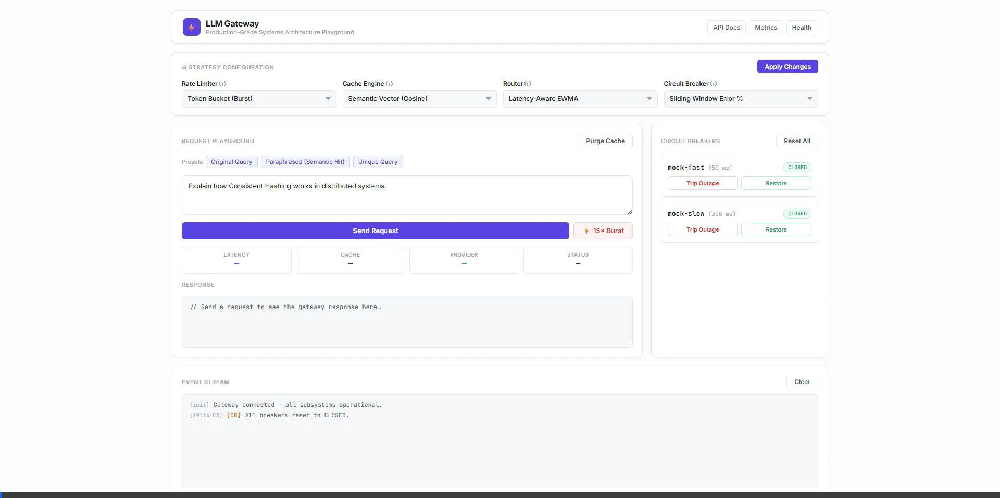

# LLM Gateway

A high-performance, asynchronous API Gateway engineered to route, rate-limit, semantically cache, and load-balance requests across multiple LLM providers (**OpenAI, Google Gemini, Perplexity, Ollama, and Mock**), implementing core Low-Level Design (LLD) and High-Level Design (HLD) algorithmic building blocks **from first principles**.

---

## 🎬 Interactive Control Plane & Visual Walkthrough



Open **`http://localhost:8000/`** to access the live web control plane and interactive playground:

-  **Runtime Strategy Switcher**: Switch between Rate Limiters, Cache Engines, Routers, and Circuit Breakers on the fly via dropdown controls with zero downtime.
-  **Dual-Tier Exact & Semantic Caching**: Send original vs. paraphrased prompts and observe cosine similarity vector hits with `<1ms` response latency.
-  **Rate Limiter Burst Tester**: Fire concurrent bursts to observe Token Bucket / Sliding Window `HTTP 429` throttling in real time.
-  **Fault Injection & Outage Simulator**: Trip individual provider circuit breakers and watch the gateway automatically failover to healthy providers with zero downtime.
-  **Full-Width Live Telemetry Stream**: Real-time event stream tracking every request, hit/miss status, reconfigurations, and provider routing decisions.

---

## 🏗️ System Architecture

```
Client (OpenAI SDK / HTTP)
       │
       ▼  POST /v1/chat/completions (with X-Correlation-ID)
┌─────────────────────────────────────────────────────────────────────────────┐
│                             LLM GATEWAY PIPELINE                            │
│                                                                             │
│  1. [RATE LIMITER]                                                          │
│     ├── Token Bucket (In-Memory Thread-Safe)                                │
│     ├── Sliding Window Log (Exact Timestamps)                               │
│     ├── Sliding Window Counter (Low-Memory Hybrid)                          │
│     └── Redis Token Bucket (Atomic Lua Script)                              │
│                                                                             │
│  2. [TWO-TIER CACHE]                                                        │
│     ├── Tier 1: Exact Match (SHA-256 Hash -> O(1) Return)                  │
│     ├── Tier 2: Semantic Vector Match (Cosine Sim >= 0.75 via Embeddings)   │
│     └── Eviction: Hand-rolled LRU (DLL + Map) or LFU (Freq Buckets)         │
│                                                                             │
│  3. [ROUTER / LOAD BALANCER]                                                │
│     ├── Round Robin                                                         │
│     ├── Latency-Aware (EWMA Smoothing)                                      │
│     ├── Cost-Aware ($/1k Tokens Optimizer)                                  │
│     └── Consistent Hashing Ring (Virtual Nodes for Sticky Sessions)         │
│                                                                             │
│  4. [CIRCUIT BREAKER & RESILIENCE]                                          │
│     ├── State Machine: CLOSED -> OPEN -> HALF_OPEN                          │
│     ├── Sliding Window Error Rate % Threshold                               │
│     └── Automatic Failover Cascade                                          │
│                                                                             │
│  5. [PROVIDER ADAPTERS]                                                     │
│     ├── OpenAI Adapter (GPT-4o / GPT-4o-mini)                               │
│     ├── Google Gemini Adapter (1.5 Flash / Pro)                             │
│     ├── Perplexity Adapter (Sonar)                                          │
│     ├── Ollama Adapter (Local Llama-3 / Mistral)                            │
│     └── Mock Provider (Deterministic Latency / Fault Injection)             │
│                                                                             │
│  6. [OBSERVABILITY & TELEMETRY]                                             │
│     ├── Prometheus Metrics (/metrics)                                       │
│     └── Structured JSON Logging with Trace Correlation IDs                  │
└─────────────────────────────────────────────────────────────────────────────┘
```

---

## ⚙️ Unified Configuration (`config/gateway_config.yaml`)

Switch between algorithms statically via YAML or dynamically via the web UI / `/gateway/reconfigure` API:

```yaml
rate_limiter:
  strategy: "token_bucket" # "sliding_window_log" | "sliding_window_counter" | "redis_token_bucket"
  default_capacity: 10
  default_refill_rate: 2.0

cache:
  strategy: "semantic_vector" # "lru_exact" | "lfu_exact" | "disabled"
  max_size: 1000
  similarity_threshold: 0.75

router:
  strategy: "latency_aware_ewma" # "round_robin" | "cost_aware" | "consistent_hashing"

circuit_breaker:
  strategy: "sliding_window_error_rate"
  failure_rate_threshold: 0.5
```

---

##  Quickstart & Running Locally

### 1. Install Dependencies
```bash
pip install -r requirements.txt
```

### 2. (Optional) Start Redis, Prometheus & Grafana
```bash
docker compose up -d
```

### 3. Start Gateway Server
```bash
python -m uvicorn src.gateway.app:app --host 127.0.0.1 --port 8000
```
Open **`http://localhost:8000/`** to interact with the visual control plane.

### 4. Send a Chat Completion Request
```bash
curl -X POST http://localhost:8000/v1/chat/completions \
  -H "Content-Type: application/json" \
  -d '{
    "messages": [{"role": "user", "content": "Explain consistent hashing in distributed systems."}],
    "tenant_id": "tenant_1"
  }'
```

### 5. Check Health & Circuit Breakers
```bash
curl http://localhost:8000/health
```

### 6. Run Automated Test Suite
```bash
pytest tests/ -v
```

### 7. Run Load Testing Harness (Locust)
```bash
locust -f tests/load/locustfile.py --host=http://localhost:8000
```
Open `http://localhost:8089` to launch concurrent simulated traffic.
